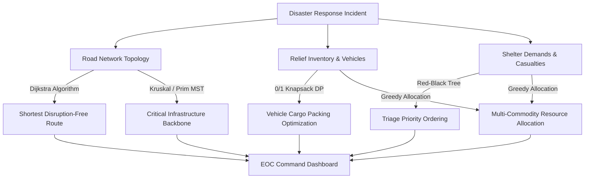
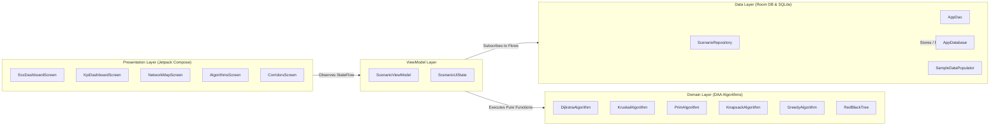
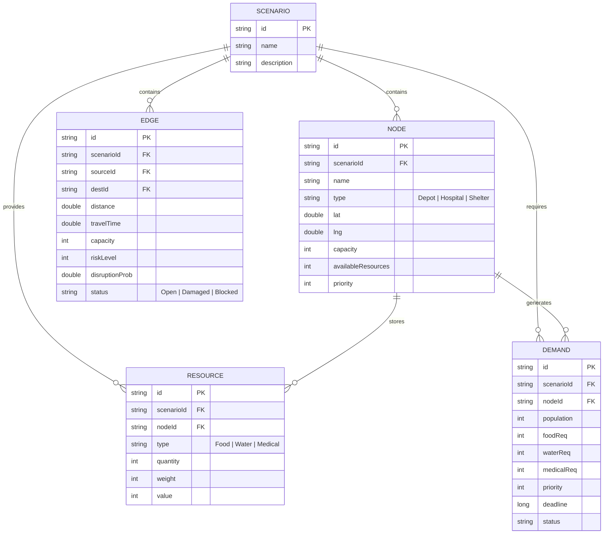

# 🚨 Disaster Response Logistics Optimization System (EOC)

[](https://kotlinlang.org)
[-3DDC84.svg?logo=android)](https://developer.android.com)
[-4285F4.svg?logo=jetpackcompose)](https://developer.android.com/jetpack/compose)
[-F58220.svg?logo=sqlite)](https://developer.android.com/training/data-storage/room)
[](#core-algorithms--computational-complexity)
[](#system-architecture)

An intelligent **Emergency Operations Center (EOC) Logistics & Supply Chain Optimization Platform** developed as an advanced **Design and Analysis of Algorithms (DAA)** project. 

The application solves high-stakes humanitarian logistics challenges during severe natural disaster crises—such as major earthquakes, flash floods, avalanches, and landslides across Nepal. By integrating classical and advanced algorithmic paradigms (Graph Theory, Greedy Heuristics, Dynamic Programming, and Self-Balancing Trees) with modern Android Jetpack Compose and reactive Room database streaming, the system provides real-time situational awareness, route calculation, critical supply rationing, and road disruption simulation.

---

## 📑 Table of Contents

- [Overview & Motivation](#-overview--motivation)
- [Key Features](#-key-features)
- [Core Algorithms & Computational Complexity](#-core-algorithms--computational-complexity)
  - [1. Dijkstra's Algorithm (Emergency Route Finding)](#1-dijkstras-algorithm-emergency-dispatch--evacuation-routing)
  - [2. Kruskal's Algorithm (Network Backbone MST)](#2-kruskals-algorithm-minimum-cost-road-reconnection)
  - [3. Prim's Algorithm (Depot-Centric Grid Expansion)](#3-prims-algorithm-depot-centric-infrastructure-expansion)
  - [4. 0/1 Knapsack Problem (Payload Utility Maximization)](#4-01-knapsack-problem-optimal-cargo-payload-packing)
  - [5. Greedy Resource Allocation (Multi-Commodity Rationing)](#5-greedy-resource-allocation-multi-commodity-rationing)
  - [6. Red-Black Tree (Triage & Priority Queueing)](#6-red-black-tree-dynamic-disaster-triage-indexing)
- [Algorithm Complexity Summary Table](#-algorithm-complexity-summary-table)
- [System Architecture](#-system-architecture)
- [Interactive User Interface & Screens](#-interactive-user-interface--screens)
- [Data Models & Schema](#-data-models--schema)
- [Preloaded Disaster Scenarios](#-preloaded-disaster-scenarios)
- [Tech Stack & Libraries](#-tech-stack--libraries)
- [Project Directory Structure](#-project-directory-structure)
- [Installation & Getting Started](#-installation--getting-started)
- [Running Unit Tests](#-running-unit-tests)
- [License & Academic Attribution](#-license--academic-attribution)

---

## 🌍 Overview & Motivation

During natural disasters (e.g., the 2015 Gorkha Earthquake or monsoon flash floods in Nepal), emergency response commanders face several critical logistical bottlenecks:
1. **Compromised Infrastructure**: Roads and bridges are blocked or collapsed, preventing standard GPS routing from functioning safely.
2. **Resource Scarcity**: Emergency vehicle capacity is strictly bounded, requiring life-saving relief cargo (medical supplies, water purification, rations) to be triaged to maximize survival utility.
3. **Multiple Competing Shelters**: Shelters, camps, and field hospitals submit urgent requests simultaneously with varying severity and deadlines.
4. **Dynamic Operational Constraints**: Roads can get blocked or cleared dynamically, necessitating real-time algorithm re-execution.

This system provides emergency response directors with a unified digital dashboard that dynamically computes optimal routing, spanning tree infrastructure, triage queues, and multi-commodity resource distribution in real time.

---

## ✨ Key Features

- 📊 **EOC Executive KPI Dashboard**: Real-time monitoring of total affected population, active supply depots, available relief inventories, and percentage demand fulfillment.
- 🗺️ **Interactive Geographic Network Map**:
  - Full touch gesture support (smooth pan, pinch-to-zoom).
  - Visual distinctions for node types (Depots, Hospitals, Shelters).
  - Live status indicators for road corridors (Open vs. Blocked).
  - Visual highlights for computed Minimum Spanning Tree (Green) and Dijkstra Shortest Paths (Blue).
- ⚙️ **Algorithm Control Panel & Workbench**: Direct interactive parameter adjustment for route search, vehicle payload capacity, and real-time algorithm inspection.
- 🚧 **Road Disruption Simulator & Real-time Rerouting**: Toggle landslides/blockages on specific road corridors to observe automatic algorithmic recalculation across Dijkstra and MST models.
- 🏔️ **10 Real-world Nepal Disaster Scenarios**: Pre-seeded scenarios ranging from Kathmandu earthquakes to Himalayan blizzards and Chitwan landslides.
- 🔄 **Reactive State Synchronization**: Built entirely on Kotlin Coroutines and Room reactive `Flow`, ensuring that database edits automatically cascade through ViewModel algorithms and trigger immediate UI updates.

---

## 🧠 Core Algorithms & Computational Complexity



### 1. Dijkstra's Algorithm (Emergency Dispatch & Evacuation Routing)
- **File**: [`DijkstraAlgorithm.kt`](app/src/main/java/com/example/daaproject/domain/algorithms/DijkstraAlgorithm.kt)
- **Logistics Purpose**: Identifies the fastest or shortest safe route between any supply depot, hospital, or evacuation shelter.
- **Handling Disruptions**: Road segments marked with `status == "Blocked"` (landslides, fallen debris, flooded bridges) are skipped dynamically by the relaxation step.
- **Data Structures**:
  - Min-Priority Queue (`PriorityQueue<Pair<String, Double>>`) for extracting the vertex with the lowest known distance.
  - Adjacency list representation: `Map<String, List<Edge>>`.
  - Parent pointers: `previousNodes` map for path reconstruction.
- **Complexity**:
  - **Time**: $\mathcal{O}((V + E) \log V)$
  - **Space**: $\mathcal{O}(V + E)$

### 2. Kruskal's Algorithm (Minimum-Cost Road Reconnection)
- **File**: [`KruskalAlgorithm.kt`](app/src/main/java/com/example/daaproject/domain/algorithms/KruskalAlgorithm.kt)
- **Logistics Purpose**: When an earthquake severs regional links, engineering and rescue teams must restore minimum connectivity across all hubs with the least clearing effort and repair distance.
- **Implementation**:
  - Valid edges (`status != "Blocked"`) are sorted ascending by distance.
  - A custom **Disjoint Set Union (DSU)** structure with **Path Compression** and **Union by Rank** ensures cycle-free edge inclusion.
- **Complexity**:
  - **Time**: $\mathcal{O}(E \log E)$ or $\mathcal{O}(E \log V)$
  - **Space**: $\mathcal{O}(V + E)$

### 3. Prim's Algorithm (Depot-Centric Infrastructure Expansion)
- **File**: [`PrimAlgorithm.kt`](app/src/main/java/com/example/daaproject/domain/algorithms/PrimAlgorithm.kt)
- **Logistics Purpose**: Constructs an MST expanding outwards directly from an active central distribution depot, ensuring that every newly added cluster maintains a direct chain of custody back to the base.
- **Implementation**:
  - Employs a Min-Priority Queue of edges (`PriorityQueue<Edge>`) and a visited vertex set to greedily select the lightest cut edge.
- **Complexity**:
  - **Time**: $\mathcal{O}(E \log V)$
  - **Space**: $\mathcal{O}(V + E)$

### 4. 0/1 Knapsack Problem (Optimal Cargo Payload Packing)
- **File**: [`KnapsackAlgorithm.kt`](app/src/main/java/com/example/daaproject/domain/algorithms/KnapsackAlgorithm.kt)
- **Logistics Purpose**: Emergency transport helicopters and relief trucks have strict gross vehicle weight ratings (payload limits). The knapsack solver determines the combination of relief supplies (Medical Kits, Food Rations, Water, Fuel) that maximizes life-saving utility without overloading the vehicle.
- **Implementation**:
  - Bottom-up 2D Dynamic Programming table: `dp[N+1][Capacity+1]`.
  - Recurrence relation:
    $$\text{dp}[i][c] = \max(\text{dp}[i-1][c],\, \text{dp}[i-1][c - w_i] + v_i)$$
  - Backtracking pass to reconstruct the exact subset of selected resources.
- **Complexity**:
  - **Time**: $\mathcal{O}(N \cdot W)$ (Pseudo-polynomial, where $N$ = items, $W$ = vehicle capacity)
  - **Space**: $\mathcal{O}(N \cdot W)$

### 5. Greedy Resource Allocation (Multi-Commodity Rationing)
- **File**: [`GreedyAlgorithm.kt`](app/src/main/java/com/example/daaproject/domain/algorithms/GreedyAlgorithm.kt)
- **Logistics Purpose**: When overall demand outstrips available stock across regional depots, resources must be rationed based on triage severity.
- **Implementation**:
  - Demands are sorted in ascending order of priority rank (Priority 1 = Critical, Priority 2 = Urgent, Priority 3 = Moderate).
  - Iteratively allocates food, potable water, and trauma kits from depot inventory to satisfy highest-priority demands first.
- **Complexity**:
  - **Time**: $\mathcal{O}(D \log D + D \cdot R)$ (where $D$ = demand hubs, $R$ = available supply batches)
  - **Space**: $\mathcal{O}(R)$

### 6. Red-Black Tree (Dynamic Disaster Triage Indexing)
- **File**: [`RedBlackTree.kt`](app/src/main/java/com/example/daaproject/domain/algorithms/RedBlackTree.kt)
- **Logistics Purpose**: Incoming emergency calls and incident reports arrive continuously. A self-balancing binary search tree maintains a dynamically sorted triage order by urgency priority, survival deadline, and incident identifier.
- **Implementation**:
  - Custom node implementation with `Color.RED` and `Color.BLACK`.
  - Standard balancing invariants maintained via `rotateLeft()`, `rotateRight()`, and `fixInsert()`.
  - In-order traversal (`getSortedDemands()`) produces an ordered queue for emergency dispatchers.
- **Complexity**:
  - **Insertion**: $\mathcal{O}(\log N)$
  - **Search / Lookup**: $\mathcal{O}(\log N)$
  - **Sorted In-Order Traversal**: $\mathcal{O}(N)$
  - **Space**: $\mathcal{O}(N)$

---

## 📊 Algorithm Complexity Summary Table

| Algorithm | Paradigm | Role in Disaster Logistics | Time Complexity | Space Complexity |
| :--- | :--- | :--- | :--- | :--- |
| **Dijkstra** | Greedy / Graph Theory | Fast dispatch & routing with road block avoidance | $\mathcal{O}((V + E) \log V)$ | $\mathcal{O}(V + E)$ |
| **Kruskal's MST** | Greedy + DSU | Minimum-distance network connectivity restoration | $\mathcal{O}(E \log E)$ | $\mathcal{O}(V)$ |
| **Prim's MST** | Greedy + Min-Heap | Central depot outward supply grid expansion | $\mathcal{O}(E \log V)$ | $\mathcal{O}(V + E)$ |
| **0/1 Knapsack** | Dynamic Programming | Vehicle cargo payload & utility optimization | $\mathcal{O}(N \cdot W)$ | $\mathcal{O}(N \cdot W)$ |
| **Greedy Allocation** | Greedy Strategy | Multi-commodity triage supply rationing | $\mathcal{O}(D \log D + D \cdot R)$ | $\mathcal{O}(R)$ |
| **Red-Black Tree** | Balanced BST | Real-time emergency triage incident prioritization | $\mathcal{O}(\log N)$ (insert) | $\mathcal{O}(N)$ |

---

## 🏗️ System Architecture

The project adheres to modern Android **Clean Architecture** and the **MVVM (Model-View-ViewModel)** design pattern.



- **Separation of Concerns**: The `domain/algorithms` package contains pure Kotlin code with no Android SDK dependencies, making all algorithms independently testable via standard JVM unit tests.
- **Reactive Data Streams**: Room DAOs return asynchronous Kotlin `Flow`s. The `ScenarioViewModel` merges node, edge, demand, and resource streams using `combine()`, dynamically re-evaluating the algorithmic models whenever data changes.

---

## 📱 Interactive User Interface & Screens

### 1. KPI Dashboard (`KpiDashboardScreen.kt`)
Presents four high-level operational indicators:
- **Total Affected**: Sum of civilian populations requiring aid across all active demand nodes.
- **Active Depots**: Count of fully operational supply and staging facilities.
- **Total Resources**: Aggregate quantity of life-saving supplies currently inventoried.
- **Demand Satisfaction %**: Metric calculated by matching total allocated supplies against requested demands via the Greedy Allocator.

### 2. Interactive Network Map (`NetworkMapScreen.kt`)
- Visualizes the disaster geography on a hardware-accelerated Compose `Canvas`.
- Implements touch-driven translation and scaling (`detectTransformGestures`) with zoom boundaries from `0.5x` to `5.0x`.
- **Node Semantics**:
  - 🔵 **Blue**: Depots (Resource hubs)
  - 🔴 **Red**: Hospitals (Emergency medical care centers)
  - ⚫ **Dark Gray**: Shelters (Evacuation & relief zones)
- **Edge Overlays**:
  - Regular corridors drawn in gray (active) or semi-transparent red (damaged).
  - **Green Overlay (Width 6px)**: Minimum Spanning Tree backbone corridors computed by Kruskal/Prim.
  - **Blue Overlay (Width 8px)**: Optimal path generated by Dijkstra's algorithm.

### 3. Algorithm Control Panel (`AlgorithmsScreen.kt`)
Provides interactive input controls:
- **Dijkstra Query**: Input Source Node ID and Target Node ID $\rightarrow$ Triggers route computation and displays exact hop-by-hop path with total route distance.
- **MST Comparison**: Live display of Kruskal and Prim total spanning tree edges and accumulated network weights.
- **Knapsack Weight Controller**: Text input to set vehicle weight capacity (default: 100) $\rightarrow$ Instantly displays maximum cargo utility and selected item list.
- **Greedy Allocation Log**: Breakdown of allocations by demand node ID.
- **Red-Black Tree Output**: In-order traversal output displaying sorted emergency demand records.

### 4. Arterial Corridors & Disruption Simulator (`CorridorsScreen.kt`)
- Displays bidirectional arterial connections between nodes.
- Shows distance (km), travel time (min), and risk levels (1/3, 2/3, 3/3).
- Provides a one-tap **"Block Road" / "Clear Road"** action button to simulate landslides or clearances and test real-time system adaptability.

---

## 🗄️ Data Models & Schema

The application uses an embedded **Room SQLite Database** with 5 primary entity tables:



---

## 🏔️ Preloaded Disaster Scenarios

On initial launch, [`SampleDataPopulator.kt`](app/src/main/java/com/example/daaproject/data/db/SampleDataPopulator.kt) automatically seeds the database with 10 real-world simulated disaster scenarios across Nepal:

| Scenario ID | Name | Disaster Type & Region | Description |
| :---: | :--- | :--- | :--- |
| `S_0` | **Kathmandu Earthquake** | Seismic Destruction | Urban collapsed structures, arterial debris, hospital access triage |
| `S_1` | **Pokhara Flood** | Flash Flood / Inundation | River swelling, bridge damages, shelter access severance |
| `S_2` | **Chitwan Landslide** | Terrain Failure / Highway Blockage | Terai arterial corridor blockage, essential supply chain cutoff |
| `S_3` | **Lalitpur Wildfire** | Urban-Forest Edge Fire | Rapid evacuation demands, burn trauma medical supply priorities |
| `S_4` | **Bhaktapur Earthquake** | Heritage & High-Density Seismic Event | Dense alley access issues, emergency medical routing |
| `S_5` | **Everest Base Camp Avalanche** | High-Altitude Cryospheric Hazard | Severe hypothermia, high-value medical payload helicopter transport |
| `S_6` | **Annapurna Blizzard** | Mountain Storm / Trekker Stranding | Route isolation, high-priority survival ration delivery |
| `S_7` | **Lumbini Heatwave** | Extreme Meteorological Event | Severe potable water shortages, vulnerable population triage |
| `S_8` | **Dharan Storm** | Severe Wind & Flash Flooding | Fallen trees, power line severances, infrastructure reconnection |
| `S_9` | **Janakpur Epidemic** | Post-Flood Waterborne Disease Outbreak | High medical utility knapsack optimization, clinic supply distribution |

---

## 🛠️ Tech Stack & Libraries

- **Programming Language**: [Kotlin](https://kotlinlang.org/) `2.2.10`
- **Android Target**: Min SDK `24` (Android 7.0 Nougat) | Target / Compile SDK `34/37` (Android 14+)
- **Build System**: Gradle 8.x with Kotlin DSL (`build.gradle.kts`) & Version Catalog (`libs.versions.toml`)
- **Annotation Processing**: [KSP (Kotlin Symbol Processing)](https://github.com/google/ksp) `2.3.8`
- **UI Framework**: [Jetpack Compose](https://developer.android.com/jetpack/compose) with Material 3 Design
- **Architecture Components**:
  - Jetpack `ViewModel` & Lifecycle runtime Compose (`2.10.0`)
  - Kotlin Coroutines & Flow (`1.11.0`)
  - Jetpack Compose Adaptive Navigation
- **Local Persistence**: [Android Room Database](https://developer.android.com/training/data-storage/room) `2.8.4` (SQLite ORM)
- **Testing**: [JUnit 4](https://junit.org/junit4/) `4.13.2`, AndroidX Test Runner & Ext JUnit

---

## 📂 Project Directory Structure

```text
disaster-response-logistics/
├── app/
│   ├── build.gradle.kts                     # App-level build script & dependencies
│   └── src/
│       ├── main/
│       │   ├── AndroidManifest.xml          # App manifest & permissions
│       │   ├── java/com/example/daaproject/
│       │   │   ├── MainActivity.kt          # App entry point, DB setup & theme wrapper
│       │   │   ├── data/
│       │   │   │   ├── dao/
│       │   │   │   │   └── AppDao.kt        # Room DAO queries & reactive Flow methods
│       │   │   │   ├── db/
│       │   │   │   │   ├── AppDatabase.kt   # Room Database class definition
│       │   │   │   │   └── SampleDataPopulator.kt # Pre-seeded Nepal scenarios
│       │   │   │   ├── entity/
│       │   │   │   │   └── Entities.kt      # Entities: Scenario, Node, Edge, Resource, Demand
│       │   │   │   └── ScenarioRepository.kt # Repository abstraction over DAO
│       │   │   ├── domain/
│       │   │   │   └── algorithms/
│       │   │   │       ├── DijkstraAlgorithm.kt # Shortest path with disruption avoidance
│       │   │   │       ├── KruskalAlgorithm.kt  # MST with Disjoint Set Union (DSU)
│       │   │   │       ├── PrimAlgorithm.kt     # MST with Priority Queue
│       │   │   │       ├── KnapsackAlgorithm.kt # 0/1 Knapsack Dynamic Programming
│       │   │   │       ├── GreedyAlgorithm.kt   # Priority-first multi-resource allocator
│       │   │   │       └── RedBlackTree.kt      # Self-balancing BST for triage indexing
│       │   │   └── ui/
│       │   │       ├── screens/
│       │   │       │   ├── EocDashboard.kt          # Host screen with Navigation Rail
│       │   │       │   ├── KpiDashboardScreen.kt    # Metrics cards (Affected, Depots, %)
│       │   │       │   ├── NetworkMapScreen.kt      # Zoomable Canvas map with path highlights
│       │   │       │   ├── AlgorithmsScreen.kt      # Interactive algorithm evaluation panel
│       │   │       │   └── CorridorsScreen.kt       # Road disruption simulation list
│       │   │       ├── theme/
│       │   │       │   ├── Color.kt                 # Material 3 color definitions
│       │   │       │   ├── Theme.kt                 # DAAProjectTheme Composable
│       │   │       │   └── Type.kt                  # Typography system
│       │   │       └── viewmodel/
│       │   │           └── ScenarioViewModel.kt     # Reactive state holder & algorithm runner
│       │   └── res/                             # Android drawables, icons, and themes
│       └── test/
│           └── java/com/example/daaproject/
│               └── AlgorithmsUnitTest.kt            # Unit test suite verifying all algorithms
├── gradle/
│   ├── libs.versions.toml                   # Gradle Version Catalog
│   └── wrapper/                             # Gradle wrapper binaries
├── build.gradle.kts                         # Root build configuration
├── settings.gradle.kts                      # Module inclusion & repository definitions
└── README.md                                # Project documentation
```

---

## 🚀 Installation & Getting Started

### Prerequisites
1. **Android Studio**: Android Studio Ladybug (2024.2+) or newer.
2. **Java Development Kit (JDK)**: JDK 17 or JDK 21 installed and set as your `JAVA_HOME`.
3. **Android SDK**: Android API level 34 or higher.

### Step-by-Step Setup

1. **Clone or Download the Repository**:
   ```bash
   git clone https://github.com/your-username/disaster-response-logistics.git
   cd disaster-response-logistics
   ```

2. **Open in Android Studio**:
   - Launch Android Studio.
   - Select **Open** and choose the `disaster-response-logistics` directory.
   - Wait for Gradle Sync to complete. The IDE will download all dependencies defined in `libs.versions.toml`.

3. **Build the Project**:
   ```bash
   # On Windows (PowerShell / Command Prompt)
   .\gradlew.bat assembleDebug

   # On macOS / Linux
   ./gradlew assembleDebug
   ```

4. **Run on Emulator or Physical Device**:
   - Ensure you have an Android device or emulator with API Level 24+ enabled.
   - Click the green **Run (▶️)** button in Android Studio or install via ADB:
   ```bash
   .\gradlew.bat installDebug
   ```

---

## 🧪 Running Unit Tests

The project includes unit tests located in [`AlgorithmsUnitTest.kt`](app/src/test/java/com/example/daaproject/AlgorithmsUnitTest.kt) that validate:
- **Dijkstra**: Verifies optimal route calculation and automatic diversion around blocked roads.
- **0/1 Knapsack**: Verifies that total utility is maximized within payload bounds.
- **Greedy Allocation**: Verifies that critical demands (Priority 1) are fulfilled before lower-priority demands.
- **Red-Black Tree**: Verifies that in-order traversal strictly sorts demands in ascending priority order.
- **Kruskal's MST**: Verifies that exactly $V - 1$ edges are selected without cycles and the minimal total weight is achieved.

To execute the unit tests from the command line:

```bash
# On Windows
.\gradlew.bat test

# On macOS / Linux
./gradlew test
```

Test reports are generated at:
```text
app/build/reports/tests/testDebugUnitTest/index.html
```

---

## 📜 License & Academic Attribution

This project is developed as an academic coursework submission for **Design and Analysis of Algorithms (DAA)**.

- **Author**: Uday Kumar & Project Contributors
- **Course**: Design and Analysis of Algorithms (CS / Software Engineering)
- **License**: MIT License — open for academic study, research, and non-commercial extension.
